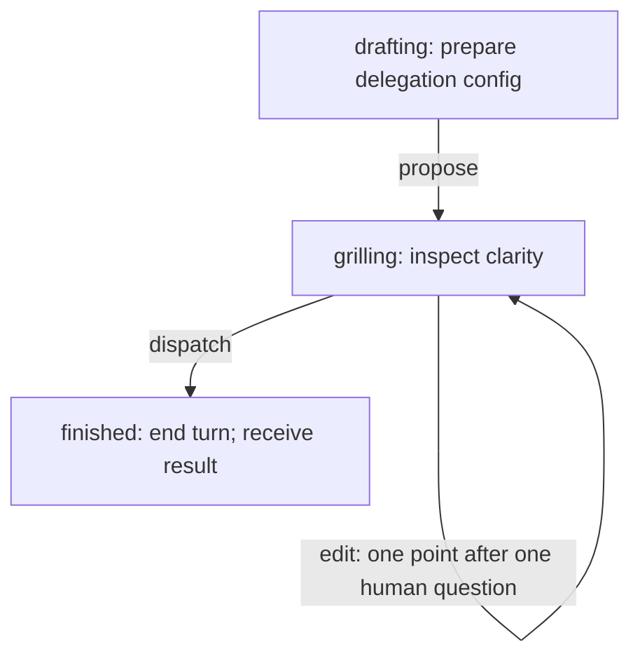
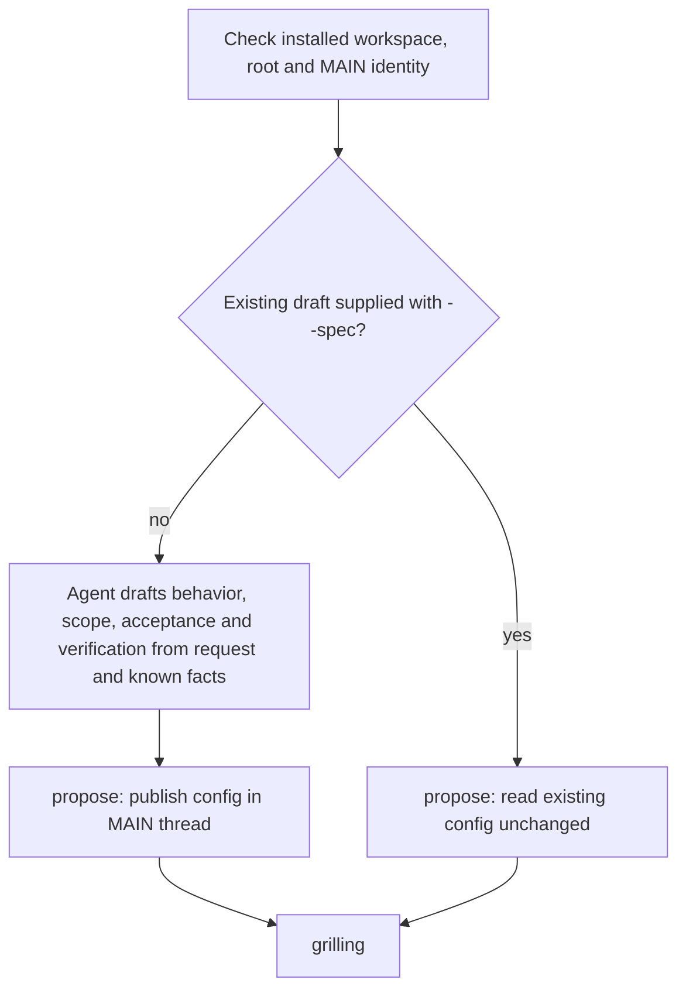
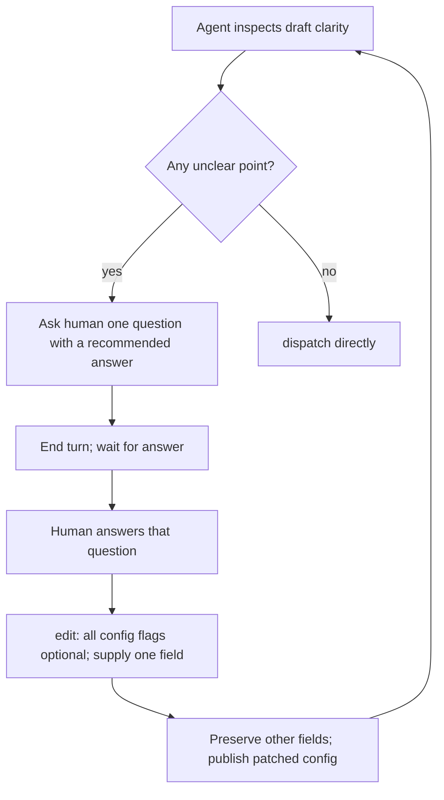
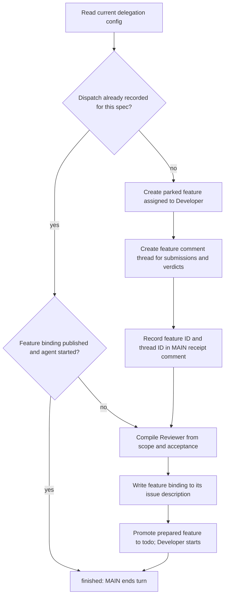
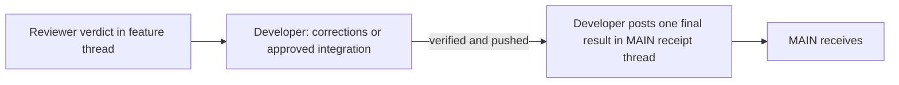

# MAIN specification and delegation SOP

State: drafting

State: grilling — unfolded interaction

State: grilling — unfolded dispatch callback

State: finished

| Graph operation | Code and durable record |
| --- | --- |
| Workspace/root/identity check | [`configured`](controller.py): native IDs must match `installation.json` |
| Draft config | [`propose`, `read_spec`](controller.py): config in MAIN's native thread |
| Human interaction and one-point patch | [`grilling` state prompt and `edit`](controller.py): optional edit flags; native questions and answers |
| Park or reuse feature | [`dispatch`](controller.py): `issue create --status backlog`; MAIN dispatch record reuses its ID |
| Threads and retry checkpoint | [`dispatch`](controller.py): feature comment + MAIN receipt; local `.state/<spec UUID>-dispatch.json` caches IDs |
| Review and final result | [`verdict`](roles/reviewer.py) steers Developer; [`integration`](roles/developer.py) delivers to MAIN |
