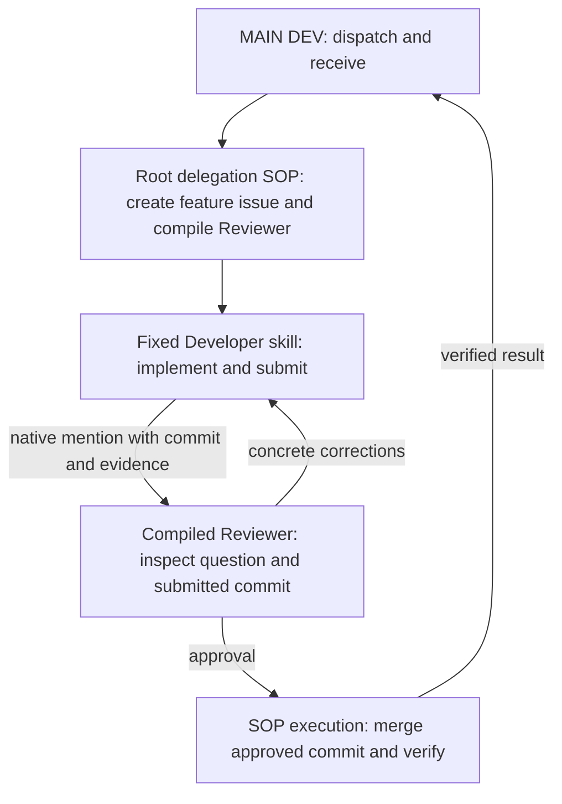

# Workflow contract

MAIN delegates one feature/fix request and receives its result. One feature issue contains implementation, independent review and corrections.

Installation is outside this chart. It collects the target/root, agents, directions, acceptance questions and test commands; prepares local skills; and updates the existing root/project descriptions in place.

## Task-bound execution

Compile the review question, default questionnaire, target issue and submitted revision into a standalone Reviewer package. This package is a supporting artifact, not another root SOP. The Reviewer invokes it under its own native task ID. The Developer's fixed procedure invokes no Reviewer action itself: it posts the bounded review request and mentions the configured Reviewer.

Developer is the workflow-executing agent inside the feature issue and owns approved integration. MAIN uses the root dispatch procedure only. The workflow-owning agent retains the feature issue's context and executes approved integration. Resume through the current task's procedure and native comment evidence. Keep the compiler small; use the supplied state/option objects and templates rather than a second workflow framework.

The explicit judgment is Reviewer approval or rework for the submitted revision. The source author cannot supply that approval. A source change after approval needs fresh review. A merge conflict aborts integration and returns to Developer for minimal correction and review. Required integration checks must pass before push. Existing `manual` holds require human acceptance.

The final notice to MAIN contains the feature issue, Reviewer verdict, integrated revision and the answer to the acceptance question. MAIN receives this result without another review request.

## Prototype evidence

Demonstrate installation reuse without duplicate agents/root records; distinct Developer/Reviewer bindings; root title beginning `MAIN DEV:`; project direction scopes and configured test commands; compiled task-bound review with the default questions; one correction loop; and approved integration with one result notice. A focused fixture may establish integrity. A later isolated sub-workspace trial against multica-RSI establishes the target integration behavior.

No benchmark machinery, AIDE solution tree, extra QUERY issue or separate Integrator role is part of this prototype.

## Executable package

`install.py` runs outside the SOP. It reads selected answers, imports owned archives,
binds skills additively, and updates managed sections of the existing root/project.
`controller.py` exports the root `Workflow`; `roles/developer.py` and
`roles/reviewer.py` supply the supporting procedures. `packages.py` copies the
bundled runtime into each package and validates it before native import. There are
no system review, distribution or delivery skill calls in the product.

Each imported role's `entry.py` materializes its package under the current target
checkout's ignored `.agents/skills/` directory and invokes its standalone wrapper.
The wrapper keeps `.state/<native task UUID>.json`. A later native task starts its
own state and reconstructs progress from the feature thread. Installation IDs and
feature bindings are configuration. Submission, review and integration records
are native comment JSON blocks; they never go in issue metadata.

A correction in another checkout uses a local branch suffixed with its native
task ID, starting at the submitted revision. It pushes to the configured feature
branch while preserving the earlier checkout's local branch and working files.

The dedicated feature thread is read with `--thread ... --tail 30`. Reviewer
verdicts must come from the configured Reviewer identity and reference the latest
submission comment and exact commit. A compiled package for an earlier commit is
rejected. Reviewer inspects a disposable checkout and explicitly chooses approval
or rework; passing checks alone cannot approve source. The approval includes the
acceptance answer and the necessary-additions and demand-match answers.

Integration uses a host lock keyed by the repository path, a fresh detached main
worktree, a merge of the approved commit, the configured test, and a normal push.
The feature branch head must still equal the approved commit. Conflicts and failed
checks produce an in-issue correction request; a subsequent task also sees that
request. A manual label requires a native member acceptance record for that SHA.
No callback marks an issue done. After push, a native integration record supports
receipt recovery; MAIN's receipt thread prevents duplicate final notices on resume.

## Prototype limits

Installation and task actions require native access to the selected project,
agents, skill imports and repository. Existing invocation permissions are preserved;
an inaccessible role must be made available by its owner before use. Keep the
installer's saved owned IDs when repeating installation. An uncertain external
write must be reconciled against native records before retrying.

The integration lock serializes one host. Separate hosts also rely on Git's normal
non-fast-forward push rejection and must retry against current main. Tests run the
explicitly configured shell command; select a focused command suitable for the
target repository. Review checkouts are disposable, and source edits belong to
Developer. This prototype does not implement a deployment service.

Repository fixtures simulate Multica records and role choices and execute real
Git operations. Live independent agent behavior and server mention admission
remain for the dedicated multica-RSI sub-workspace trial. Current Research and RSI
installations are outside this prototype's test scope.
