# Shipping flow

Installer creates its own parked MAIN child and configures roles, returning one
self-contained missing question per invocation. MAIN then clarifies the request and passes a short name;
the configured direction prefix formats the feature branch. The child uses its
native issue folder for one shared [procedure](../roles/feature.py):

```dot
digraph develop_review {
  rankdir=LR; node [shape=box];
  develop [label="Developer: implement, test and submit"];
  review [label="Reviewer: inspect exact revision"];
  integrate [label="Developer: test, integrate and report to MAIN"];
  finished [label="Reported to MAIN"];
  develop -> review [label="submit"];
  review -> develop [label="rework"];
  review -> integrate [label="approve"];
  integrate -> finished [label="integrate"];
}
```

Both roles use the current issue folder and the same metadata record. The native
agent ID guards each phase. MAIN's `--name tree-horizontal-more` plus installed
`branch_prefix: feat/frontend` binds `feat/frontend/tree-horizontal-more` before dispatch.
Developer starts directly on the issue's existing branch. Neither role names or creates it.
Later actions reject another branch or repository; review and integration also reject a changed HEAD.
The first push claims an unused remote name; correction pushes lease the prior submission.
Features share no branch registry or SOP-wide lock.
A manual label on MAIN is copied before the child starts. Review never creates a checkout or switches branches;
it checks the existing tree and submitted HEAD in place. A manual label, conflict
or failed integration is reported to the parent; the child workflow finishes.
Human acceptance owns done.

Reviewer only reads and returns a verdict. Developer owns all tests and Git
writes. Approval hands integration back to Developer. Each successful delivery
posts one recipient TODO with a result link. Steering requires a matching running
recipient with `can_supplement: true`; otherwise the mention takes the normal route.
The sender receives only "Delivery/review/work done this round, exit directly and
silently", including integration and already-reported calls. Metadata and HTML
retain the receiving role's guidance. Failures remain errors. This is guidance,
not enforced turn completion or a measured token saving; enforcement belongs to
the runner ([multica-RSI#40](https://github.com/Winfred666/multica-RSI/issues/40)).
Wrong-role action calls exit nonzero on stderr without JSON or writes.

Select `review` in the HTML graph to see the two default questions from
[`common.QUESTIONS`](../common.py). A running review also shows the issue's
request, scope and configured acceptance question. MAIN sets that question with
`propose --question` and can revise it with `edit --question` before dispatch.
Reviewer receives the questions together in one `review` state and returns one
`--finding` with `approve` or `rework`. Their order is presentation order, not
per-question stepping or parallel reviewer tasks. MAIN's clarification loop
still asks the human one question at a time.

The HTML graph comes from `Workflow`; action docstrings explain local logic.
`DEBUG` defaults to `true` in the root and newly built packages' `config.json`.
During native runs, each state change or completion publishes an HTML graph
highlighting the actual resulting state. Selecting a node only inspects its
guidance; it does not advance the workflow. Package rebuilds retain existing
settings, so enable `DEBUG` explicitly in older packages. No renderer service
is required.
