# Developing the shipping SoPs

## Source layout and packages

```text
installation/                Installer: SKILL.md, controller.py, install.py, packages.py
  featssship.py, config.json  Shared helpers and DEBUG default
delegation/                  MAIN: SKILL.md, controller.py, github_issue.py
  dev-rev/                   Developer–Reviewer: SKILL.md, controller.py
```

From `installation/`, use `packages.build('installation', destination)`,
`packages.build('delegation', destination)` or `packages.build('feature', destination)`.
The builder supplies shared helpers/config and validates with `multica sop dev validate DIRECTORY`.
Installer packages include both child SoPs. Deployment builds directly into `.agents/skills/`,
preserving config. Dispatch copies the dev-rev package into each prepared child worktree
before starting it, without replacing an existing package. Updates leave in-flight copies untouched.
The CLI supplies the engine; each SKILL.md declares `metadata: {sop: symbolic}`.

## Shipping flow

Installation has two states:

```dot
digraph installation {
  rankdir=LR; node [shape=box];
  grilling [label="grilling: align config with the requested workflow"];
  finished [label="finished: retain MAIN checkpoint; update only"];
  grilling -> grilling [label="edit JSON merge patch; attach config; ask edit or confirm; end this turn silently if not outer-confirmed"];
  grilling -> finished [label="confirmed by human: set up roles/local skills and create/reuse MAIN"];
  finished -> finished [label="update: refresh saved MAIN's local delegation and owned context"];
}
```



Defaults and field comments guide each edit toward the requested workflow. Keep
settings that already fit, and edit again as needed. Ask one human question only
when context leaves something unclear. Editing does not create
roles, local skills or MAIN. Confirmation must be a human reply after the latest config
comment. The human only replies `confirm`; the agent runs `confirmed` and the
script finds that reply automatically. The JSON role key is `delegator`. The installer owns one logical master JSON
attachment containing installation settings and defaults. MAIN receives only
its explicit owner/filename reference in `featssship.config`, not copied defaults
or an installer-parent link. It subscribes CEO and runs independently after the
installer reaches retained ordinary state `finished`, whose sole option is `update`.
Re-entry preserves settings and MAIN identity; its immediate MAIN checkpoint remains
for retries and updates. [Update commands](../README.md#update) use the latest
source without changing delegation progress, platform skill bindings or existing
dev-rev issues and their local packages.
Installation does not publish platform skills or change agent skill assignments.
Dispatch and handoff prompts use `multica sop run NAME`. Both roles
run it from the prepared issue worktree, without agent-installed skills.

Attachment revisions temporarily replace unavailable native mutable deliverables.
`featssship.py` isolates upload and authenticated download/read, with TODOs for native
update/preview. Grilling publishes a confirmation prompt with each attachment revision in the
existing thread; other revisions use an empty-rendering comment. Readers select the latest matching owner/filename. References
remain valid after edits, across issues. Serialize edits; immutable attachments
provide no compare-and-swap. Old revisions remain history. Defaults are created
only when the master document is absent. Nothing caches JSON locally or in SoP
state. Cached guidance contains routing text only, not rendered configuration.
See [README](../README.md#configuration) for editing. Runtime resolution has no
metadata fallback or ancestry lookup. Stale owned MAIN configuration can be
deleted on upgrade; retain live execution checkpoints and unrelated data.

The project description still owns verification guidance and repository/scope
context, never selected review questions or installed identities.
The installer action graphs live in [its controller](../installation/controller.py).

MAIN runs one sequential batch with `--thread <request UUID>` and optional
`--config '{"issues":[{}]}'` (one default item). Grilling shows a fresh JSON working
copy; `refresh --config-file PATH` replaces the whole batch and invalidates approval.
Dispatch requires the original member's confirmation or acceptance after that
draft before creating children or branches. Partial failures retain checkpoints
and retry in grilling without restarting successful children. Once a child exists,
resume dispatch rather than refreshing.

Children share the delegation attachment by item index; universal settings resolve
from the installer master and verification commands from the project description.

MAIN passes a short name;
the configured direction prefix formats the feature branch. The child uses its
prepared issue worktree for one shared [procedure](../delegation/dev-rev/controller.py).

The DEBUG HTML is compiled from that controller’s `Workflow`, including both
approval and integration-result diamonds and the shared registered action.

Both roles use the current issue folder and the same metadata record. The native
agent ID guards each phase. MAIN's `name: tree-horizontal-more` plus installed
`branch_prefix: feat/frontend` binds `feat/frontend/tree-horizontal-more` before dispatch.
Developer owns only develop; Reviewer owns all subsequent states. Neither role names or creates the branch.
Later actions reject another branch or repository; review and integration also reject a changed HEAD.
Dispatch prepares the metadata-selected local branch and one issue-owned worktree.
`manual` is a boolean inherited from installation and overridable per batch item.
Only manual mode creates/pushes a remote feature branch; its first push leases
the reserved revision and corrections lease the prior submission. Automatic
features stay local until their approved result is pushed to the existing parent branch.
Features share no branch registry or SOP-wide lock.
A manual config adds the manual label before the child starts. Review never
creates a checkout or switches branches. Automated review approval passes through
the manual-config diamond directly to the registered `final_approve` action; there is no automatic approval State.
Manual approval waits in `manual_approve` for human or MAIN input, then uses the
same action. The engine runs that action and the integration-result diamond
until a State is reached. Integration checks the exact approved HEAD, rebases/tests,
and fast-forwards local main in its clean existing worktree (or atomically advances
its unoccupied ref). No feature worktree changes branch. The integration-result
diamond routes errors to Reviewer diagnosis and changed
revisions to develop for fresh submission and approval. Rebase conflicts retain
the interrupted rebase for Developer corrections. Success continues directly
through local feature cleanup, parent push and MAIN delivery, then retains `done`
for an explicit outer-requested amendment without another review loop.
A rejected push restores the local feature branch/worktree for rework. There is
no reported state, final-state action or finish command.

Cancellation is available in develop and review for scope, Git/version
infrastructure or edit-budget blockers, and in manual_approve for outer
cancellation. Preserve or commit edits first. The script deletes the local
feature tree/branch, marks the issue cancelled and enters finished without tests,
integration or pushes. Reviewer may invoke this fixed cleanup but remains
read-only for source; approved integration runs the scripted checks. Human acceptance owns done.

State owners resolve native `{id, name}` in the wrapper for actor checks,
handoffs and tiny HTML labels.

Submission and rework return `this_round_reply_guidance`: the acting agent uses
`multica-peer-mention-protocol` to post one direct handoff in the current issue
thread, mentioning the receiving role, then ends the turn silently. The engine
keeps the destination's ordinary guidance, ownership and later callbacks intact;
only this invocation's output is masked. No local handoff hook posts or steers
these comments. Manual review retains its ordered outer-approval checkpoint and
returns wait guidance. Reports to MAIN remain receipt-only `/note` comments under
the original dispatch thread, without mentions or steering. Failures remain errors.
Wrong-role calls exit nonzero on stderr without JSON or writes.

Select `review` to inspect the request, scope and selected questions.
The installation direction's `questions` apply by default; a delegation `questions`
list replaces them. Reviewer returns one `--finding` with `approve` or `rework`.
Question order is presentation order, not per-question stepping or parallel tasks.

The HTML graph comes from `Workflow`; action docstrings explain local logic.
`DEBUG` defaults to `true` in the source bundles and newly built packages' `config.json`.
During native runs, each state change or completion publishes an HTML graph
highlighting the actual resulting state. Selecting a node only inspects its
guidance; it does not advance the workflow. Package rebuilds retain existing
settings, so enable `DEBUG` explicitly in older packages. No renderer service
is required. Callbacks use `multica sop run NAME`; the CLI resolves repository-local
skills before installed skills.

Implementation note: delegation declares only `grilling`; runtime-owned `FINISHED`
is the ringed-circle target that deletes only its SOP key and emits callback-free
exit guidance. See `multica sop dev docs` for completion modes.
