# Developing the shipping SoPs

## Source layout and packages

```text
installation/                  Installer and shared config/CLI helpers
delegation/common/             Install-time router, shared batch drafting and GitHub links
delegation/normal/             Normal delegation controller and SKILL.md
  dev-rev/                     Unchanged shipping procedure/controller
delegation/split/              Experiment delegation controller and SKILL.md
  devrev_split/                Reviewer-owned procedure and canonical score adapter
```

From `installation/`, use `packages.build('installation', destination)`,
`packages.build('delegation', destination)` or `packages.build('feature', destination)`.
[packages.build](../installation/packages.py) copies helpers/child bundles and validates with
`multica sop dev validate DIRECTORY`. Build the installer at the persistent target's
`.agents/skills/multica-featssship-installation/` using the [README commands](../README.md#installer-agent).
[install.deploy](../installation/install.py) then installs MAIN/shipping bundles under `.agents/skills/`.
Dispatch copies dev-rev into each child worktree; updates leave in-flight copies untouched.
Split counterparts are `split-delegation` and `split-feature`; `delegation/common/router.py` selects the pair at installation/update.
The CLI supplies the engine; each SKILL.md declares `metadata: {sop: symbolic}`.

[DiscoverSOPs](https://github.com/Winfred666/multica-RSI/blob/396df1773ea3629146b3556fd87e4d2c85e868a7/server/internal/cli/sop.go#L43-L99)
finds repository-local `.agents/skills/` from the command working directory.
[save_state](https://github.com/Winfred666/multica-RSI/blob/396df1773ea3629146b3556fd87e4d2c85e868a7/server/internal/cli/sop/wrapper.py#L182-L187)
saves that directory in `sop.<name>.workdir`;
[runRemoteSOP](https://github.com/Winfred666/multica-RSI/blob/396df1773ea3629146b3556fd87e4d2c85e868a7/server/internal/daemon/remote_sop.go#L51-L78)
reruns `multica sop run NAME` there with the daemon environment, not the caller's shell.
Keep the recorded directory/bundles accessible to that runtime. Moving a bundle does
not migrate `workdir`; fresh checkouts do not inherit these local files.

## Shipping flow

Installation separates agent drafting, outer confirmation and retained installation:

```dot
digraph installation {
  rankdir=LR; node [shape=box];
  edit [label="edit: align config with the requested workflow"];
  outer_decide [label="outer_decide: outer decides in this installation issue/current thread"];
  finished [label="finished: retain MAIN checkpoint; update only"];
  edit -> outer_decide [label="publish JSON merge patch; attach config and change context; end turn silently"];
  outer_decide -> edit [label="request_edit: one change request for agent drafting"];
  outer_decide -> finished [label="confirm: validate, set up roles/local skills and create/reuse MAIN"];
  finished -> finished [label="update: refresh saved MAIN's local delegation and owned context"];
}
```



Installer `edit` drafts the saved JSON; ask one human question only for unresolved choices.
`publish` attaches the config/change request and enters the native questionnaire in
this installation issue/current thread, then ends the turn silently. Outer `confirm`
executes installation; `request_edit --change-request` returns to drafting.
Drafting creates no roles, local skills or MAIN. The JSON role key is `delegator`.
Independent MAIN receives only the `featssship.config` owner/filename reference;
CEO is subscribed. Saved MAIN/agent IDs survive retries. The retained `finished`
state offers only [update](../README.md#update), preserving settings, MAIN identity,
delegation progress and in-flight dev-rev copies. Installation does not publish
platform skills or change agent skill assignments. MAIN runs from the persistent
target root; shipping roles use their prepared issue worktree.

Attachment revisions temporarily replace unavailable native mutable deliverables.
`featssship.py` isolates upload and authenticated download/read, with TODOs for native
update/preview. Draft publications carry the change request beside the attachment;
other revisions render empty. The engine publishes the outer questionnaire after the final action. Readers select the latest matching owner/filename. References
remain valid after edits, across issues. Serialize edits; immutable attachments
provide no compare-and-swap. Old revisions remain history.
See [README](../README.md#configuration) for editing.
The installer action graphs live in [its controller](../installation/controller.py).

MAIN runs one sequential batch with `--thread <request UUID>` and optional
`--config '{"issues":[{}]}'` (one default item). Agent-owned `edit` shows a JSON
working copy. `refresh --config-file PATH` validates and publishes the whole batch,
including its first publication, then enters addressed-owner `outer_decide`. The final
refresh action returns minimal `this_round_reply_guidance` for a brief change
explanation; the engine publishes the native questionnaire in self
`MULTICA_ISSUE_ID` and the current thread. Outer `confirm` directly dispatches;
`request_changes --change-request TEXT` returns to MAIN drafting with that request. No comment
confirmation scan or responder restriction is added. Partial failures retain
checkpoints and retry with `confirm` without restarting successful children.
Once a child exists, resume dispatch rather than editing or refreshing.

MAIN passes a short name;
the configured direction prefix formats the feature branch. The child uses its
prepared issue worktree for one shared [procedure](../delegation/normal/dev-rev/controller.py).

The controller registers each action once and binds routing with native
`Workflow(edges=((source, destination), ...))` pairs as the sole topology.
Branch selectors return outgoing destination names; the integration-result
diamond uses the preceding action’s phase. No target, route-map or static-choice
declarations duplicate the pairs. The CLI compiles the DEBUG HTML from this graph,
including the nested approval and integration-result diamonds.
State retry loops pause normally; no local graph adapter or renderer is used.

Both roles use the current issue folder and the same metadata record. The native
agent ID guards each phase. MAIN's `name: tree-horizontal-more` plus installed
`branch_prefix: feat/frontend` binds `feat/frontend/tree-horizontal-more` before dispatch.
Developer owns develop; Reviewer owns review and integration recovery. Manual approval
is addressed to MAIN's delegator. Neither role names or creates the branch.
Later actions reject another branch or repository; review rejects a changed submitted HEAD.
Integration accepts the approved revision or its scripted rebase checkpoint, not unrelated source edits.
Dispatch prepares the selected local branch and one issue-owned worktree.
`manual` is a boolean inherited from installation and overridable per batch item.
Only manual mode creates/pushes a remote feature branch; its first push leases
the reserved revision and corrections lease the prior submission. Automatic
features stay local until their approved result is pushed to the existing parent branch.
Features share no branch registry or SOP-wide lock.
A manual config adds the manual label before the child starts. Review never
creates a checkout or switches branches. Automated review approval passes through
the manual-config diamond directly to the registered `final_approve` action; there
is no automatic approval State.
Manual approval addresses the engine questionnaire to the concrete delegator agent,
using `main_issue_id` and `dispatch_thread` from the linked delegation JSON.
Outer approval directly runs the same action; outer rework passes correction arguments
straight to Developer through a native mention/steer handoff. The engine runs the action and the
integration-result diamond until a State is reached. Integration checks the exact approved HEAD, rebases/tests,
and fast-forwards local main in its clean existing worktree (or atomically advances
its unoccupied ref). A clean rebase hash change alone retains approval and updates
the integrated revision. No feature worktree changes branch. The integration-result
diamond routes all unsuccessful outcomes, including conflicts and rejected pushes,
to Reviewer evaluation and recovery. `rework` selected by Reviewer or outer returns to develop
for fresh submission, review and any required outer approval. Rebase conflicts retain
the interrupted rebase; Reviewer chooses rework when Developer corrections are
needed. Success continues directly through local feature cleanup, parent push and MAIN delivery, then retains `done`
for an explicit outer-requested amendment without another review loop. Completion
reply guidance only requests silent exit; later `done` guidance states the feature
is already pushed and offers amendment.
A rejected push restores the local feature branch/worktree before Reviewer
evaluation. There is no reported state, final-state action or finish command.

Cancellation is available in develop and review for scope, Git/version
infrastructure or edit-budget blockers, and in manual_approve for outer
cancellation. Preserve or commit edits first. The script deletes the local
feature tree/branch, marks the issue cancelled and enters finished without tests,
integration or pushes. Reviewer may invoke this fixed cleanup but remains
read-only for source; approved integration runs the scripted checks. Human acceptance owns done.

State owners resolve native `{id, name}` in the wrapper for actor checks,
handoffs and tiny HTML labels.

Submission and rework return `this_round_reply_guidance`: the acting agent uses
`multica-peer-mention-protocol` to post one direct handoff in the current issue
thread, mentioning the receiving role, then ends the turn silently. The template
supplies the exact mention, submitted commit, full-diff link and numeric deltas;
only a brief feature-wide explanation needs filling. Size-ranked files are labeled
as numeric context, not a complete feature explanation. No peer auto-posting,
steering or handcrafted special-comment publication remains. The engine
keeps the destination's ordinary guidance, ownership and later callbacks intact;
only this invocation's output is masked. Only outer edit/rework callbacks wake agents.
The final review action entering addressed approval returns minimal
reply guidance to explain the changes and end the turn. The engine publishes and
forwards its ordinary questionnaire; no separate wait comment, comment-scanning
approval gate or responder restriction is added. Amendment still requires a separate
explicit outer request. Completion reports to MAIN remain receipt-only `/note`
comments under the original dispatch thread, without mentions or steering. Failures remain errors.
Wrong-role calls exit nonzero on stderr without JSON or writes.

Select `review` to inspect the request, scope and selected questions.
The installation direction's `questions` apply by default; a delegation `questions`
list replaces them. Reviewer returns one `--finding` with `approve` or `rework`.
Question order is presentation order, not per-question stepping or parallel tasks.

The HTML graph comes from `Workflow`; action docstrings explain local logic.
`DEBUG` defaults to `true` in the source bundles and newly built packages' `config.json`.
During native runs, each state change or completion publishes an HTML graph
highlighting the actual resulting state. Selecting a node only inspects its
guidance; it does not advance the workflow. Package rebuilds retain existing
settings, including `DEBUG: false`, so enable `DEBUG` explicitly in older packages.
The CLI uploads the config and graph as independent artifacts, soft-linked via
issue metadata `independent_artifacts`, not ordinary issue-owned attachments.
The graph updates on state changes/completion, not every recall. Publication
failures are written to stderr and do not by themselves fail the SoP. No renderer service
is required. Callbacks use `multica sop run NAME`; the CLI resolves repository-local
skills before installed skills.

Implementation note: delegation declares `edit` and `outer_decide`; runtime-owned `FINISHED`
is the ringed-circle target that deletes only its SOP key and emits callback-free
exit guidance. See `multica sop dev docs` for completion modes.

## Split experiment flow

```text
MAIN: split delegation (same native batch confirmation)
  -> Reviewer exp issue: ready -> prepare -> develop (addressed to Developer)
       -> Developer exp issue: build variant, attach/update image and answer candidate_ready
          (commit, summary, committed pipeline file, visual image attachment ID)
     -> review -> submit(--review) [evaluate once, validate JSON, post to MAIN] -> finished
```

Reviewer retains the SoP record and identity throughout. The native engine
publishes the questionnaire in Reviewer's issue and forwards its link/agent
mention to the Developer issue. Developer follows that question's `!sop-remote`
answer instructions, not `sop run`. The engine executes the callback under the
owning Reviewer task; Developer never receives a Reviewer credential.
MAIN prepares a Reviewer thread and passes it in the issue's `--thread` command;
Reviewer prepares a Developer thread for the addressed questionnaire. The
Developer callback wakes Reviewer in the saved Reviewer thread, not the
Developer issue's trigger thread.
The Reviewer submit action enters terminal `finished`, which clears native SoP
state. It first marks both issues `in_review`, not `done`, and saves the public
`featssship.experiment_submitted` receipt. That receipt prevents another evaluation
even if the issue is reopened. Acceptance remains outside
the experiment. Publication retries before completion reuse the saved real score,
not another evaluation. The review text is a required submit argument.

The existing owner/filename/index config links resolve installation roles,
directions, scope and questions. Developer receives the same public reference,
not a copy containing hidden data. No evaluator path, inputs, command output or
credential is published in those attachments, comments, candidate worktrees or
SoP state. Public direction `test_command` must be `evaluate.py`; no shared
shell command is executed for scoring. Existing normal test commands are unchanged.

The fixed minimal split context is `delegation/split/PROJECT.md`. Installation
injects it into its owned project-description block only for that selected bundle,
without replacing unrelated project context. Experiment issue descriptions retain
it too. It encourages an ontology module dictionary and a pipeline of connected
modules; every Reviewer experiment names its variant using the delegated name.
Developer commits its detailed local pipeline file and attaches an initial visual
image at development start, then updates that image as the pipeline changes.
`this_round_reply_guidance` in prepare carries this Developer instruction, and
the native addressed questionnaire forwards the same text to Developer. The
candidate_ready callback rejects the base or an empty-change commit, requires a
committed pipeline blob and an image attached or independently linked to the
Developer issue, then notifies Reviewer. These checks prove artifacts exist, not
that the work is relevant or complete; Reviewer must judge that. Reviewer sees the
committed pipeline and visual before submitting. No module schema or framework
is imposed. The installer question about develop_reviewer_split is optional
edit-state guidance, not a prerequisite to publish or confirm.

### Private evaluation boundary

The current daemon task credential is **not** a filesystem sandbox. Distinct
agents on the same Unix UID can read each other's known paths, including 0600
files. A second folder/runtime ID or instructions alone cannot hide inputs.
Scoring therefore fails closed until an operator provisions dedicated,
unprivileged Developer and Reviewer Unix accounts and binds their existing
agents to runtimes running under those accounts. Neither account may switch to
the other, use sudo/docker/host-admin access, or share private mounts. Do not
reconfigure agents automatically. Native task API scopes and issue visibility
are not used to store secrets.

On the Reviewer's host the operator supplies
`/etc/multica-featssship/split/<reviewer-agent-UUID>.json`:

```json
{
  "reviewer_uid": 1201,
  "developer_uid": 1202,
  "developer_id": "<actual Developer agent UUID>",
  "reviewer_runtime_id": "<actual Reviewer runtime UUID>",
  "developer_runtime_id": "<actual Developer runtime UUID>",
  "evaluators": {"<installed direction>": "/private/reviewer/evaluation"}
}
```

These are schema examples, not configured identities. The two policy directories
and file must be root-owned and not group/world writable. Do not put hidden
inputs in the policy. It binds actual runtime accounts, not their display names;
the operator must verify and maintain those bindings. The adapter checks the
calling UID, distinct non-root Developer UID, agent/runtime bindings and private
directory ownership/mode. The CLI cannot attest a remote process's Unix UID;
root-owned host policy is the trust anchor. The existing same-user runtime
layout does not satisfy this policy and is not claimed to be isolated.

Each evaluator directory is Reviewer-owned mode **0700**; Unix DAC denies the
Developer account traversal regardless of group membership. It contains the
real hidden inputs and trusted Reviewer-owned `evaluate.py`, not group/world
writable. Keep the directory outside repositories and Developer-accessible
mounts. No hidden assets are included in a built bundle. There is no connection
to any deleted hidden-test repository.

The canonical invocation, in that private directory, is:

```text
python3 evaluate.py --candidate /private/temporary/candidate.tar
stdout: {"score": <finite JSON number>}
```

`score.py` exports the exact submitted Git commit as a tar archive, never the
mutable working tree. `evaluate.py` is trusted evaluation code, not candidate
code. It may inspect the archive directly. If it executes candidate code, the
operator-provided evaluator must run that code in an OS sandbox with **no hidden
files, Reviewer credentials, host access or network** and pass only public test
inputs. The adapter does not execute candidate code or provide that sandbox.
Do not enable executable candidates without that boundary. Reviewer runs the
adapter inside the single `submit --review TEXT` action, which validates exactly one finite numeric
`score`, excluding booleans and extra fields. Only that score is saved/published;
private stdout/stderr and failures are withheld.

The action saves `evaluation_attempted` before starting the canonical process.
No retries after evaluator failure, malformed output or interruption. Missing
policy/inputs can be supplied before the first attempt. An interrupted attempt
without a saved score has no result; do not fabricate one. Delivery posts one
`{"score": number}` JSON block plus required `--review` text, the variant, local
pipeline path, visual image and candidate revision as
a receipt-only `/note` in MAIN's original dispatch thread. It makes no merge,
integration or push call. MAIN policy, source integration and human approval are
not altered.
