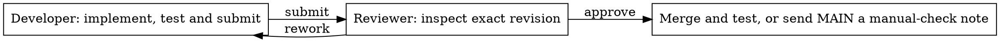

# Shipping flow

MAIN installs/configures roles, clarifies the request and supplies the feature
branch. The child then runs one shared [procedure](../roles/feature.py):

Both roles use the current issue folder and the same metadata record. The native
agent ID guards each phase. Review never creates a checkout or switches branches;
it checks the existing tree and submitted HEAD in place. A manual label, conflict
or failed integration is reported to the parent; the child workflow finishes.
Human acceptance owns done.

Select `review` in the HTML graph to see the two default questions from
[`common.QUESTIONS`](../common.py). A running review also shows the issue's
request, scope and configured acceptance question. MAIN sets that question with
`propose --question` and can revise it with `edit --question` before dispatch.
Reviewer receives the questions together in one `review` state and returns one
`--finding` with `approve` or `rework`. Their order is presentation order, not
per-question stepping or parallel reviewer tasks. MAIN's clarification loop
still asks the human one question at a time.

The HTML graph comes from `Workflow`; action docstrings explain local logic.
`DEBUG` defaults to `true` in the root and newly built packages' `config.json`.
During native runs, each state change or completion publishes an HTML graph
highlighting the actual resulting state. Selecting a node only inspects its
guidance; it does not advance the workflow. Package rebuilds retain existing
settings, so enable `DEBUG` explicitly in older packages. No renderer service
is required.
