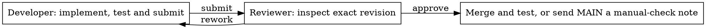

# Shipping flow

MAIN installs/configures roles, clarifies the request and supplies the feature
branch. The child then runs one shared [procedure](../roles/feature.py):

Both roles use the current issue folder and the same metadata record. The native
agent ID guards each phase. A manual label, conflict or failed integration is
reported to the parent; the child workflow finishes. Human acceptance owns done.

The HTML graph comes from `Workflow`; action docstrings explain local logic.
`DEBUG` defaults to `true` in the root and newly built packages' `config.json`.
During native runs, each state change or completion publishes an HTML graph
highlighting the actual resulting state. Selecting a node only inspects its
guidance; it does not advance the workflow. Package rebuilds retain existing
settings, so enable `DEBUG` explicitly in older packages. No renderer service
is required.
