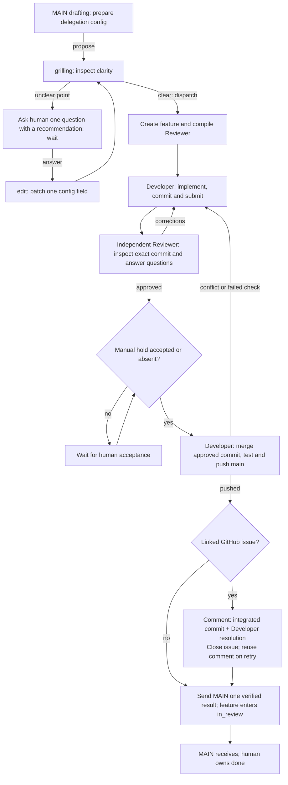

# Shipping flow

| Executable procedure | States and callback internals |
| --- | --- |
| [MAIN delegation](../controller.py) | [Delegation graph](../DEBUG.md) |
| [Developer](../roles/developer.py) | [Developer graphs](../roles/developer-debug.md) |
| [Reviewer](../roles/reviewer.py) | [Reviewer graphs](../roles/reviewer-debug.md) |

The fixture simulates Multica/GitHub actions with real Git operations. Live agent
judgment and server routing remain outside that evidence. Integration locking
covers one host; normal Git push rejects competing updates across hosts.
