# Developing the shipping SoPs

## Source layout and packages

```text
installation/                Installer: SKILL.md, controller.py, install.py, packages.py
  featssship.py, config.json  Shared helpers and DEBUG default
delegation/                  MAIN: SKILL.md, controller.py, github_issue.py
  dev-rev/                   Developer–Reviewer: SKILL.md, controller.py
```

From `installation/`, use `packages.build('installation', destination)`,
`packages.build('delegation', destination)` or `packages.build('feature', destination)`.
The builder supplies shared helpers/config and validates with `multica sop dev validate DIRECTORY`.
Installer packages include both child SoPs. Deployment builds directly into `.agents/skills/`,
preserving config. Dispatch copies the dev-rev package into each prepared child worktree
before starting it, without replacing an existing package. Updates leave in-flight copies untouched.
The CLI supplies the engine; each SKILL.md declares `metadata: {sop: symbolic}`.

## Shipping flow

Installation separates agent drafting, outer confirmation and retained installation:

```dot
digraph installation {
  rankdir=LR; node [shape=box];
  edit [label="edit: align config with the requested workflow"];
  outer_decide [label="outer_decide: outer decides in this installation issue/current thread"];
  finished [label="finished: retain MAIN checkpoint; update only"];
  edit -> outer_decide [label="publish JSON merge patch; attach config and change context; end turn silently"];
  outer_decide -> edit [label="request_edit: one change request for agent drafting"];
  outer_decide -> finished [label="confirm: validate, set up roles/local skills and create/reuse MAIN"];
  finished -> finished [label="update: refresh saved MAIN's local delegation and owned context"];
}
```



Defaults and field comments guide each edit toward the requested workflow. Keep
settings that already fit, and edit again as needed. Ask one human question only
when context leaves something unclear. Editing does not create
roles, local skills or MAIN. Publishing enters the native addressed-owner questionnaire
in the installation issue and current thread, including the first publication when
no edits are needed. The attachment retains the change request. Native ownership
publishes the questionnaire and accepts its answer; final-hop
`this_round_reply_guidance` only ends the publication turn silently. Outer chooses
`confirm` to run installation directly, or `request_edit --change-request` to return to
`edit` for agent drafting. Native node names are unique, so the change-request
action is distinct from the `edit` State. The addressed owner’s `issue_id` and
`thread` select this installation issue/current thread; its required agent `id`
transports callbacks and is not the outer decision-maker. The engine handles
questionnaire answers; installation does not inspect comment authors, wording or ordering. The JSON role key is `delegator`. The installer owns one logical master JSON
attachment containing installation settings and defaults. MAIN receives only
its explicit owner/filename reference in `featssship.config`, not copied defaults
or an installer-parent link. It subscribes CEO and runs independently after the
installer reaches retained ordinary state `finished`, whose sole option is `update`.
Re-entry preserves settings and MAIN identity; its immediate MAIN checkpoint remains
for retries and updates. [Update commands](../README.md#update) use the latest
source without changing delegation progress, platform skill bindings or existing
dev-rev issues and their local packages.
Installation does not publish platform skills or change agent skill assignments.
Dispatch and handoff prompts use `multica sop run NAME`. Both roles
run it from the prepared issue worktree, without agent-installed skills.

Attachment revisions temporarily replace unavailable native mutable deliverables.
`featssship.py` isolates upload and authenticated download/read, with TODOs for native
update/preview. Draft publications carry the change request beside the attachment;
other revisions render empty. The engine publishes the outer questionnaire after the final action. Readers select the latest matching owner/filename. References
remain valid after edits, across issues. Serialize edits; immutable attachments
provide no compare-and-swap. Old revisions remain history.
See [README](../README.md#configuration) for editing.
The installer action graphs live in [its controller](../installation/controller.py).

MAIN runs one sequential batch with `--thread <request UUID>` and optional
`--config '{"issues":[{}]}'` (one default item). Agent-owned `edit` shows a JSON
working copy. `refresh --config-file PATH` validates and publishes the whole batch,
including its first publication, then enters addressed-owner `outer_decide`. The final
refresh action returns minimal `this_round_reply_guidance` for a brief change
explanation; the engine publishes the native questionnaire in self
`MULTICA_ISSUE_ID` and the current thread. Outer `confirm` directly dispatches;
`request_changes --change-request TEXT` returns to MAIN drafting with that request. No comment
confirmation scan or responder restriction is added. Partial failures retain
checkpoints and retry with `confirm` without restarting successful children.
Once a child exists, resume dispatch rather than editing or refreshing.

MAIN passes a short name;
the configured direction prefix formats the feature branch. The child uses its
prepared issue worktree for one shared [procedure](../delegation/dev-rev/controller.py).

The controller registers each action once and binds routing with native
`Workflow(edges=((source, destination), ...))` pairs as the sole topology.
Branch selectors return outgoing destination names; the integration-result
diamond uses the preceding action’s phase. No target, route-map or static-choice
declarations duplicate the pairs. The CLI compiles the DEBUG HTML from this graph,
including the nested approval and integration-result diamonds.
State retry loops pause normally; no local graph adapter or renderer is used.

Both roles use the current issue folder and the same metadata record. The native
agent ID guards each phase. MAIN's `name: tree-horizontal-more` plus installed
`branch_prefix: feat/frontend` binds `feat/frontend/tree-horizontal-more` before dispatch.
Developer owns develop; Reviewer owns review and integration recovery. Manual approval
is addressed to MAIN's delegator. Neither role names or creates the branch.
Later actions reject another branch or repository; review rejects a changed submitted HEAD.
Integration accepts the approved revision or its scripted rebase checkpoint, not unrelated source edits.
Dispatch prepares the selected local branch and one issue-owned worktree.
`manual` is a boolean inherited from installation and overridable per batch item.
Only manual mode creates/pushes a remote feature branch; its first push leases
the reserved revision and corrections lease the prior submission. Automatic
features stay local until their approved result is pushed to the existing parent branch.
Features share no branch registry or SOP-wide lock.
A manual config adds the manual label before the child starts. Review never
creates a checkout or switches branches. Automated review approval passes through
the manual-config diamond directly to the registered `final_approve` action; there
is no automatic approval State.
Manual approval addresses the engine questionnaire to the concrete delegator agent,
using `main_issue_id` and `dispatch_thread` from the linked delegation JSON.
Outer approval directly runs the same action; outer rework passes correction arguments
straight to Developer through native handover. The engine runs the action and the
integration-result diamond until a State is reached. Integration checks the exact approved HEAD, rebases/tests,
and fast-forwards local main in its clean existing worktree (or atomically advances
its unoccupied ref). A clean rebase hash change alone retains approval and updates
the integrated revision. No feature worktree changes branch. The integration-result
diamond routes all unsuccessful outcomes, including conflicts and rejected pushes,
to Reviewer evaluation and recovery. `rework` selected by Reviewer or outer returns to develop
for fresh submission, review and any required outer approval. Rebase conflicts retain
the interrupted rebase; Reviewer chooses rework when Developer corrections are
needed. Success continues directly through local feature cleanup, parent push and MAIN delivery, then retains `done`
for an explicit outer-requested amendment without another review loop. Completion
reply guidance only requests silent exit; later `done` guidance states the feature
is already pushed and offers amendment.
A rejected push restores the local feature branch/worktree before Reviewer
evaluation. There is no reported state, final-state action or finish command.

Cancellation is available in develop and review for scope, Git/version
infrastructure or edit-budget blockers, and in manual_approve for outer
cancellation. Preserve or commit edits first. The script deletes the local
feature tree/branch, marks the issue cancelled and enters finished without tests,
integration or pushes. Reviewer may invoke this fixed cleanup but remains
read-only for source; approved integration runs the scripted checks. Human acceptance owns done.

State owners resolve native `{id, name}` in the wrapper for actor checks,
handoffs and tiny HTML labels.

Submission and rework return `this_round_reply_guidance`: the acting agent uses
`multica-peer-mention-protocol` to post one direct handoff in the current issue
thread, mentioning the receiving role, then ends the turn silently. The template
supplies the exact mention, submitted commit, full-diff link and numeric deltas;
only a brief feature-wide explanation needs filling. Size-ranked files are labeled
as numeric context, not a complete feature explanation. No peer auto-posting,
steering or handcrafted special-comment publication remains. The engine
keeps the destination's ordinary guidance, ownership and later callbacks intact;
only this invocation's output is masked. No local handoff hook posts or steers
these comments. The final review action entering addressed approval returns minimal
reply guidance to explain the changes and end the turn. The engine publishes and
forwards its ordinary questionnaire; no separate wait comment, comment-scanning
approval gate or responder restriction is added. Amendment still requires a separate
explicit outer request. Completion reports to MAIN remain receipt-only `/note`
comments under the original dispatch thread, without mentions or steering. Failures remain errors.
Wrong-role calls exit nonzero on stderr without JSON or writes.

Select `review` to inspect the request, scope and selected questions.
The installation direction's `questions` apply by default; a delegation `questions`
list replaces them. Reviewer returns one `--finding` with `approve` or `rework`.
Question order is presentation order, not per-question stepping or parallel tasks.

The HTML graph comes from `Workflow`; action docstrings explain local logic.
`DEBUG` defaults to `true` in the source bundles and newly built packages' `config.json`.
During native runs, each state change or completion publishes an HTML graph
highlighting the actual resulting state. Selecting a node only inspects its
guidance; it does not advance the workflow. Package rebuilds retain existing
settings, so enable `DEBUG` explicitly in older packages. No renderer service
is required. Callbacks use `multica sop run NAME`; the CLI resolves repository-local
skills before installed skills.

Implementation note: delegation declares `edit` and `outer_decide`; runtime-owned `FINISHED`
is the ringed-circle target that deletes only its SOP key and emits callback-free
exit guidance. See `multica sop dev docs` for completion modes.
