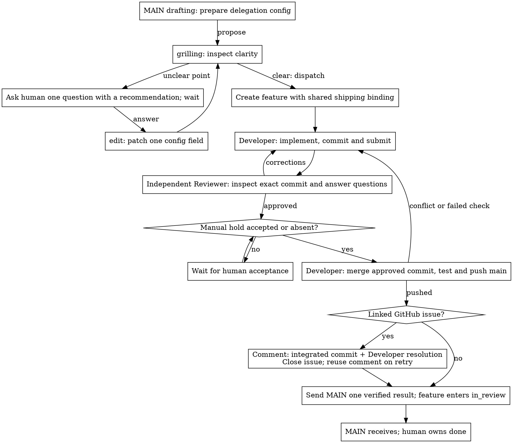

# Shipping flow

| Executable procedure | State graph and callback logic |
| --- | --- |
| [MAIN delegation](../controller.py) | `workflow`; `propose`, `edit`, `dispatch` docstrings |
| [Shared Developer–Reviewer shipping](../roles/feature.py) | `workflow`; phase identity guard and action docstrings |

The runtime compiles each state graph from its `Workflow` declarations. Action
docstrings supply local logic only. Enable `DEBUG` in the installed package's
`config.json` for a selectable HTML preview; package rebuilds retain this setting
and existing issue state.

The fixture simulates Multica/GitHub actions with real Git operations. Live agent
judgment and server routing remain outside that evidence. The platform serializes agents within an issue; normal Git push rejects competing
main updates across issues.
