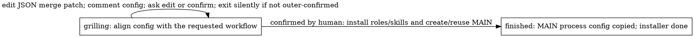

# Shipping flow

Installation has two states:

Defaults and field comments guide each edit toward the requested workflow. Keep
settings that already fit, and edit again as needed. Ask one human question only
when context leaves something unclear. Editing does not create
roles, skills or MAIN. Confirmation must be a human reply after the latest config
comment. The human only replies `confirm`; the agent runs `confirmed` and the
script finds that reply automatically. The JSON role key is `delegator`, while
the independent issue keeps its `MAIN DEV:` title. Installation metadata alone owns
init settings and proven installed_* checkpoints; there are no local answers or
binding JSON files. MAIN is created without a parent and its ID is saved in the
active installation record for retries. Re-entry after completion keeps saved config and creates another MAIN.
MAIN subscribes CEO and stores `installation_issue_id` beside its process settings.
The installer enters done while MAIN continues independently. Each feature stores
`main_issue_id` beside its shipping settings. Identities and init defaults resolve
through these explicit references, never installation-parent ancestry.
Before replacing shared skills, installation converts legacy stored parent links
to these explicit metadata references across the workspace. Existing references
and all other process settings remain unchanged; runtime resolution has no ancestry fallback.
The project description receives repository/scope/test context,
never questions or installed IDs. Upgrades replace only the installer's marked
block and remove the previous full-config record from MAIN.
The installer action graphs live in [its controller](../roles/installation.py).

MAIN delegation also has only `grilling` and `finished` states. Pass the known
request config with `--config` on first activation; it starts in grilling. Use
`edit --patch` to change config, staying in grilling while anything is uncertain.
Dispatch requires complete fields. Config and the saved child checkpoint remain
under MAIN's `featssship.delegation` metadata after dispatch; no comment lookup,
local config file, drafting stage or propose action is needed. Retry dispatch
resumes the same child; a new request supplies a new thread and config.
`test_command` is not a delegation field or copied child setting. The feature
verifier reads the selected direction’s check from the installer-owned project
description; MAIN does not copy it from installation metadata.

MAIN passes a short name;
the configured direction prefix formats the feature branch. The child uses its
prepared issue worktree for one shared [procedure](../roles/feature.py):

```dot
digraph develop_review {
  rankdir=LR; node [shape=box];
  develop [label="Developer: implement, test and submit"];
  review [label="Reviewer: inspect exact revision"];
  approval [shape=diamond, label="manual config?"];
  approve [label="Developer: auto-approved action"];
  manual_approve [label="manual_approve: wait for outer instruction"];
  merge_result [shape=diamond, label="Merge conflict / rework?"];
  finished [label="finished: cleaned, pushed if approved, reported", peripheries=2];
  develop -> review [label="submit"];
  review -> develop [label="rework"];
  review -> approval [label="approve"];
  approval -> approve [label="automatic"];
  approval -> manual_approve [label="manual"];
  approve -> merge_result [label="approve: merge_approved"];
  manual_approve -> merge_result [label="approve: same merge_approved; ONLY outer allowed"];
  manual_approve -> develop [label="rework: ONLY outer allowed"];
  develop -> finished [label="cancel: cleanup only"];
  review -> finished [label="cancel: cleanup only"];
  manual_approve -> finished [label="cancel: cleanup only; ONLY outer allowed"];
  merge_result -> develop [label="rework"];
  merge_result -> finished [label="merged: cleanup then push automatically"];
}
```

Both roles use the current issue folder and the same metadata record. The native
agent ID guards each phase. MAIN's `name: tree-horizontal-more` plus installed
`branch_prefix: feat/frontend` binds `feat/frontend/tree-horizontal-more` before dispatch.
Developer starts directly on the issue's existing branch. Neither role names or creates it.
Later actions reject another branch or repository; review and integration also reject a changed HEAD.
Dispatch prepares the metadata-selected local branch and one issue-owned worktree.
`manual` is a boolean inherited from installation and overridable per delegation.
Only manual mode creates/pushes a remote feature branch; its first push leases
the reserved revision and corrections lease the prior submission. Automatic
features stay local until their approved result is pushed to the existing parent branch.
Features share no branch registry or SOP-wide lock.
A manual config adds the manual label before the child starts. Review never
creates a checkout or switches branches. Automated review approval hands the
Developer the `approve` action; manual approval waits in `manual_approve` for
human or MAIN input. Both approval options call the same `merge_approved`
function. It checks the exact approved HEAD, merges/tests, and fast-forwards local
main in its clean existing worktree (or atomically advances its unoccupied ref).
No feature worktree changes branch. The merge-result diamond comes before terminal
finished: conflicts return to develop with the unresolved merge preserved, for a
resolution merge commit and another review. Success continues directly through
local feature cleanup, parent push and MAIN delivery, then enters finished.
A rejected push restores the local feature branch/worktree for rework. There is
no reported state, final-state action or finish command.

Cancellation is available in develop and review for scope, Git/version
infrastructure or edit-budget blockers, and in manual_approve for outer
cancellation. Preserve or commit edits first. The script deletes the local
feature tree/branch, marks the issue cancelled and enters finished without tests,
integration or pushes. Reviewer may invoke this fixed cleanup but remains
read-only for source, tests and integration. Human acceptance owns done.

Declare `Branch('merge_result', ..., {'rework': 'develop', 'merged': 'finished'})`
in `Workflow` to validate the destinations and expose the HTML diamond. The
Python action implements Git operations and returns the selected phase; Branch
itself does not execute a function. A Python if/returned phase can run without
Branch, but then the graph cannot show that global decision and its destinations
are not branch-validated. A DOT docstring explains local logic only. Because terminal
states have no actions, the success tail runs in the incoming action before
returning finished. Shared runtime/renderer files stay unchanged.

Each successful delivery
posts one concise recipient mention without TODO, self-reference or SHA. Developer and
MAIN labels use their configured agent names; the temporary Reviewer target is
`6076f4d4-e65c-40c0-91f8-fdea02ff84c0` with label `reviewer`.
Reports to MAIN are receipt-only notes under the original dispatch comment, using
`[@all](mention://all/all)` to suppress implicit agent wakeups, with no agent mention
or steering. The child feature link remains available for manual review. The dispatch
thread is retained in the feature's process configuration. Manual decisions are
interpreted by the acting agent; the script checks superior identity and ordering,
not literal approval wording. A blocked recipient outcome fails the handoff rather
than reporting delivery success. Steering requires a matching running
recipient with `can_supplement: true`; otherwise the mention takes the normal route.
The sender exits silently after handoff: "Rework sent, directly and silently exit"
for rework, the conditional superior wait for manual approval, and otherwise
"Delivery/review/work done this round, exit directly and silently". Metadata and HTML
retain the receiving role's guidance. Failures remain errors. This is guidance,
not enforced turn completion or a measured token saving; enforcement belongs to
the runner ([multica-RSI#40](https://github.com/Winfred666/multica-RSI/issues/40)).
Wrong-role action calls exit nonzero on stderr without JSON or writes.

Select `review` to inspect the issue's criteria and selected process questions.
Installation initializes each direction's string-list `questions`; MAIN copies
only the selected direction's list into a feature, together with its feature-specific
Acceptance question. Reviewer returns one `--finding` with `approve` or `rework`.
Question order is presentation order, not per-question stepping or parallel tasks.
MAIN's clarification loop still asks the human one question at a time, exiting
silently if outer confirmation has not been received yet.

The HTML graph comes from `Workflow`; action docstrings explain local logic.
`DEBUG` defaults to `true` in the root and newly built packages' `config.json`.
During native runs, each state change or completion publishes an HTML graph
highlighting the actual resulting state. Selecting a node only inspects its
guidance; it does not advance the workflow. Package rebuilds retain existing
settings, so enable `DEBUG` explicitly in older packages. No renderer service
is required.
