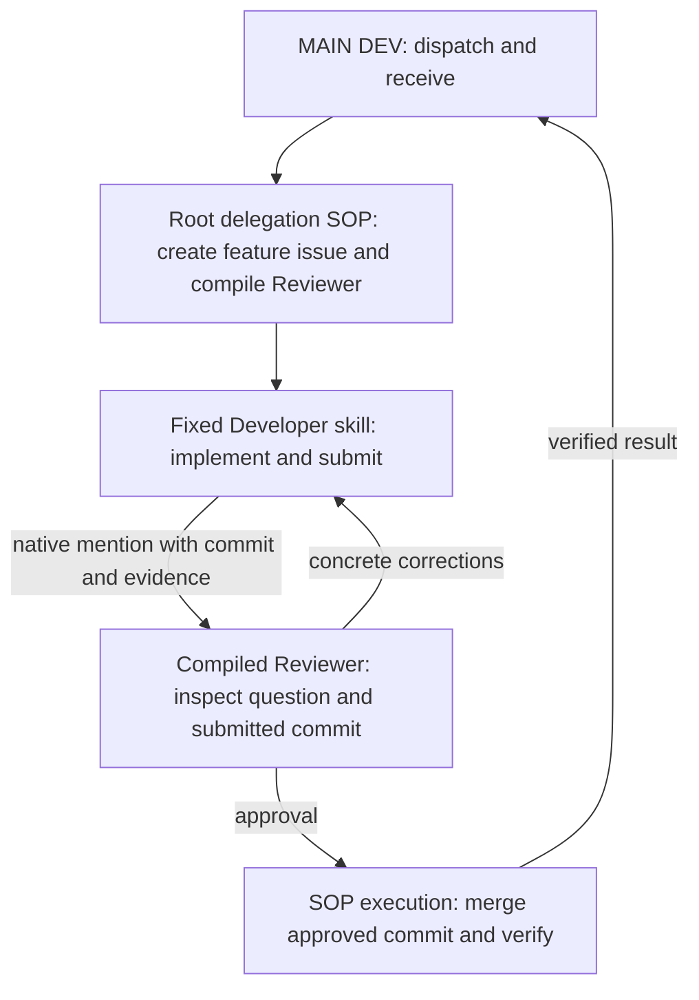

# Workflow contract

MAIN delegates one feature/fix request and receives its result. One feature issue contains implementation, independent review and corrections.

Installation is outside this chart. It collects the target/root, agents, directions, acceptance questions and test commands; prepares local skills; and updates the existing root/project descriptions in place.

## Task-bound execution

Compile the review question, default questionnaire, target issue and submitted revision into a standalone Reviewer package. This package is a supporting artifact, not another root SOP. The Reviewer invokes it under its own native task ID. The Developer's fixed procedure invokes no Reviewer action itself: it posts the bounded review request and mentions the configured Reviewer.

The workflow-owning agent retains the feature issue's context and executes approved integration. Resume through the current task's procedure and native comment evidence. Keep the compiler small; use the supplied state/option objects and templates rather than a second workflow framework.

The explicit judgment is Reviewer approval or rework for the submitted revision. The source author cannot supply that approval. A source change after approval needs fresh review. A merge conflict aborts integration and returns to Developer for minimal correction and review. Required integration checks must pass before push. Existing `manual` holds require human acceptance.

The final notice to MAIN contains the feature issue, Reviewer verdict, integrated revision and the answer to the acceptance question. MAIN receives this result without another review request.

## Prototype evidence

Demonstrate installation reuse without duplicate agents/root records; distinct Developer/Reviewer bindings; root title beginning `MAIN DEV:`; project direction scopes and configured test commands; compiled task-bound review with the default questions; one correction loop; and approved integration with one result notice. A focused fixture may establish integrity. A later isolated sub-workspace trial against multica-RSI establishes the target integration behavior.

No benchmark machinery, AIDE solution tree, extra QUERY issue or separate Integrator role is part of this prototype.
