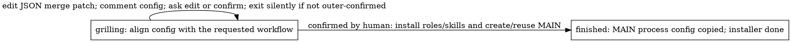

# Shipping flow

Installation has two states:

Defaults and field comments guide each edit toward the requested workflow. Keep
settings that already fit, and edit again as needed. Ask one human question only
when context leaves something unclear. Editing does not create
roles, skills or MAIN. Confirmation must be a human reply after the latest config
comment. The human only replies `confirm`; the agent runs `confirmed` and the
script finds that reply automatically. The JSON role key is `delegator`, while
the child issue keeps its `MAIN DEV:` title. Installation metadata alone owns
init settings and proven installed_* checkpoints; there are no local answers or binding JSON files. MAIN is discovered
among installer children and subscribes CEO. On success only direction questions
(string lists), branch prefixes and the manual boolean are copied to MAIN process metadata; the installer
enters done. A feature receives only its selected questions, full branch, parent
branch, manual boolean and inherited sandbox process settings. Identities and init defaults resolve
through ancestry. The project description receives repository/scope/test context,
never questions or installed IDs. Upgrades replace only the installer's marked
block and remove the previous full-config record from MAIN.
The installer action graphs live in [its controller](../roles/installation.py).

MAIN delegation also has only `grilling` and `finished` states. Pass the known
request config with `--config` on first activation; it starts in grilling. Use
`edit --patch` to change config, staying in grilling while anything is uncertain.
Dispatch requires complete fields. Config and the saved child checkpoint remain
under MAIN's `featssship.delegation` metadata after dispatch; no comment lookup,
local config file, drafting stage or propose action is needed. Retry dispatch
resumes the same child; a new request supplies a new thread and config.
`test_command` is not a delegation field or copied child setting. The feature
verifier reads the selected direction’s check from the installer-owned project
description; MAIN does not copy it from installation metadata.

MAIN passes a short name;
the configured direction prefix formats the feature branch. The child uses its
prepared issue worktree for one shared [procedure](../roles/feature.py):

```dot
digraph develop_review {
  rankdir=LR; node [shape=box];
  develop [label="Developer: implement, test and submit"];
  review [label="Reviewer: inspect exact revision"];
  manual_approve [label="manual_approve: wait for superior approve/rework/cancel"];
  finished [label="Developer: integrate, delete locally, push parent, report"];
  reported [label="Reported to MAIN"];
  develop -> review [label="submit"];
  review -> develop [label="rework"];
  develop -> finished [label="cancel: blocker"];
  review -> finished [label="approve, automatic"];
  review -> manual_approve [label="approve, manual"];
  manual_approve -> finished [label="approve: ONLY outer allowed"];
  manual_approve -> develop [label="rework: ONLY outer allowed"];
  manual_approve -> finished [label="cancel: ONLY outer allowed"];
  completion [shape=diamond, label="Integration outcome?"];
  finished -> completion [label="finish: integrate, delete locally, push parent"];
  completion -> develop [label="merge conflict or rejected push: rework"];
  completion -> reported [label="finished/cancelled"];
}
```

Both roles use the current issue folder and the same metadata record. The native
agent ID guards each phase. MAIN's `name: tree-horizontal-more` plus installed
`branch_prefix: feat/frontend` binds `feat/frontend/tree-horizontal-more` before dispatch.
Developer starts directly on the issue's existing branch. Neither role names or creates it.
Later actions reject another branch or repository; review and integration also reject a changed HEAD.
Dispatch prepares the metadata-selected local branch and one issue-owned worktree.
`manual` is a boolean inherited from installation and overridable per delegation.
Only manual mode creates/pushes a remote feature branch; its first push leases
the reserved revision and corrections lease the prior submission. Automatic
features stay local until their approved result is pushed to the existing parent branch.
Features share no branch registry or SOP-wide lock.
A manual config adds the manual label before the child starts. Review never creates a checkout or switches branches;
it checks the existing tree and submitted HEAD in place. Manual automated approval waits in manual_approve; a human or MAIN must approve, request rework or cancel. Developer alone executes those outer choices. In finished,
Developer integrates, deletes only this issue’s local branch/worktree, then
automatically pushes the integrated commit to the remote parent in both modes.
Merge conflicts return directly to develop with the unresolved merge preserved;
resolve it with an additional merge commit and resubmit for review. Rejected
parent pushes restore the local branch/worktree for rework. Other failures
preserve the work and report the problem. There is no separate integration stage.
Cancellation is available in develop for scope, Git/version infrastructure or
edit-budget blockers, and in manual_approve for outer cancellation. Preserve or
commit edits first. It marks the issue cancelled and enters finished for local
cleanup, without tests, integration or feature pushes. Human acceptance owns done.

Reviewer only reads and returns a verdict. Developer owns all tests and Git
writes. Approval hands integration back to Developer. Each successful delivery
posts one recipient TODO with a result link. Steering requires a matching running
recipient with `can_supplement: true`; otherwise the mention takes the normal route.
The sender exits silently after handoff: "Rework sent, directly and silently exit"
for rework, the conditional superior wait for manual approval, and otherwise
"Delivery/review/work done this round, exit directly and silently". Metadata and HTML
retain the receiving role's guidance. Failures remain errors. This is guidance,
not enforced turn completion or a measured token saving; enforcement belongs to
the runner ([multica-RSI#40](https://github.com/Winfred666/multica-RSI/issues/40)).
Wrong-role action calls exit nonzero on stderr without JSON or writes.

Select `review` to inspect the issue's criteria and selected process questions.
Installation initializes each direction's string-list `questions`; MAIN copies
only the selected direction's list into a feature, together with its feature-specific
Acceptance question. Reviewer returns one `--finding` with `approve` or `rework`.
Question order is presentation order, not per-question stepping or parallel tasks.
MAIN's clarification loop still asks the human one question at a time, exiting
silently if outer confirmation has not been received yet.

The HTML graph comes from `Workflow`; action docstrings explain local logic.
`DEBUG` defaults to `true` in the root and newly built packages' `config.json`.
During native runs, each state change or completion publishes an HTML graph
highlighting the actual resulting state. Selecting a node only inspects its
guidance; it does not advance the workflow. Package rebuilds retain existing
settings, so enable `DEBUG` explicitly in older packages. No renderer service
is required.
